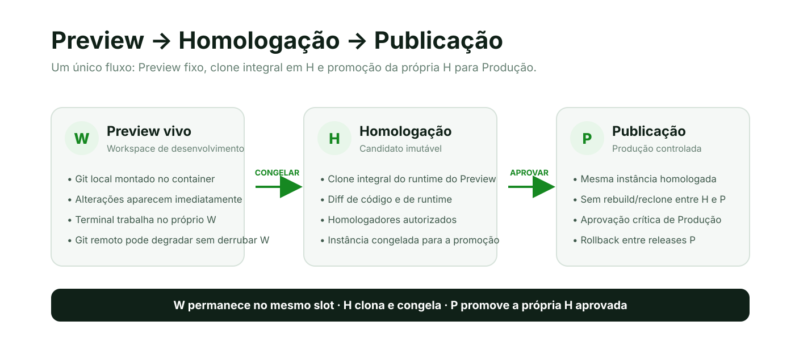
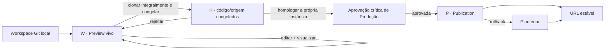

# Fluxo W → H → P de publicação

A CloudIFF separa desenvolvimento, validação e produção em três estágios explícitos: **W · Preview**, **H · Homologação** e **P · Publicação**. O objetivo é permitir desenvolvimento contínuo sem transformar cada alteração em uma release e, ao mesmo tempo, garantir que Produção receba exatamente o artefato que foi homologado.



## Resumo

| Estágio | Significado | Natureza | Função principal |
|---|---|---|---|
| **W** | Workspace / Preview | Vivo e mutável | Desenvolver e visualizar alterações imediatamente. |
| **H** | Homologation / Homologação | Código/clone congelado; configuração explícita controlada | Congelar a origem do Preview, testar e permitir ajustes deliberados de variáveis antes do aceite. |
| **P** | Publication / Publicação | Instância promovida e controlada | Colocar em Produção a mesma instância homologada; alterações posteriores de variáveis são explícitas do estágio P. |

A regra central é simples:

> **W muda continuamente; H congela código/origem e permite ajustes explícitos de configuração; P promove a mesma H, sem rebuild.**

## W · Preview vivo

O Preview é o ambiente de trabalho contínuo e **fixo** do projeto. Há um único slot/identidade Preview ativo por projeto; alterações aceitas no Forgejo são sincronizadas para esse mesmo slot e endereço, sem criar W2/W3 ou um novo Preview por commit. A implementação pode reiniciar/recriar componentes internos quando necessário, mas a identidade lógica e a URL pública do Preview permanecem estáveis.

Características do W:

- possui um container/stack de Preview próprio e estável, por exemplo `cloudif-p1007-w1-preview-web`;
- usa hostname no formato `<numero>-w<N>-preview.cloudiff.duckdns.org`; o `N` identifica o slot, **não** uma nova geração para cada commit;
- monta o checkout Git local no runtime;
- usa as variáveis do ambiente **Preview**;
- oferece terminal no próprio container W;
- bloqueia exposição pública de `.git`, `.env` e metadados equivalentes;
- não é substituído por outro Preview como consequência normal de um commit; recuperação excepcional do slot exige preservar sua identidade/URL e registrar a operação;
- não cria H ou P automaticamente;
- o estado homologável inclui a camada gravável/rootfs atual do runtime e volumes pertencentes ao projeto, não apenas o conteúdo do Git.

### Alterações manuais de runtime no Preview

Se o usuário autorizado entrar no Terminal do W e instalar um pacote/runtime manualmente, essa alteração acompanha W→H quando ainda estiver presente no container no momento do clone integral. Exemplo: instalar PHP no Preview faz a H capturada depois conter essa instalação; P mantém o mesmo estado porque a própria H é promovida.

Um `restart` do mesmo container preserva a camada gravável; uma recriação do Preview a partir da imagem original pode descartá-la. Por isso alterações permanentes devem preferir imagem/código/configuração gerenciada. Mudança feita depois de H existir exige nova H.

### Git indisponível

O Preview é **fail-soft** para indisponibilidade do remoto Git. Se Forgejo ou a rede estiverem temporariamente indisponíveis e existir uma cópia local válida, W continua no ar e o usuário recebe uma mensagem de sincronização degradada.

Esse modo degradado não autoriza uma promoção silenciosa. A criação de H exige novamente validação da procedência do código. Se o remoto estiver indisponível ou houver conflito entre alterações locais e remotas, o envio para Homologação é bloqueado até a situação ser reconciliada.

## H · Homologação congelada em relação ao Forgejo

Quando o Preview está pronto para validação, a ação **Enviar Preview para homologação** cria um **clone integral do estado runtime do Preview** e congela esse clone como candidato H. A origem da H é o Preview saudável corrente, não um rebuild independente a partir do Git.

O snapshot inclui:

- commit Git sintético do estado exato do workspace, sem alterar a branch de trabalho do usuário;
- imagem do runtime do Preview;
- rootfs/camada gravável efetivamente presente nos containers no instante do clone;
- digest da imagem;
- configuração runtime efetivamente usada pelo Preview e suas referências protegidas de segredo, preservadas sem publicar valores;
- diff de código;
- resumo das alterações relevantes do runtime;
- identificação do Preview de origem, como `W1`.

O hostname segue o padrão `<numero>-h<N>-homologation.cloudiff.duckdns.org`.

Depois da criação, H é congelada em relação ao Forgejo: código/imagens não recebem commits novos automaticamente. O usuário autorizado ainda pode alterar variáveis do próprio estágio H; essa configuração explícita passa a compor o estado homologado. O desenvolvedor pode continuar alterando W sem modificar o código do candidato. Quando uma nova H é criada, a H anterior deixa de ser ativa e seu runtime pode ser removido após preservar snapshot/evidência.

### Homologadores

O responsável pelo projeto pode definir homologadores adicionais. A autorização para homologar é específica do projeto e não transforma automaticamente a pessoa em administradora da plataforma.

Um candidato pode ficar em estados como:

- `awaiting_homologation`;
- `homologated`;
- `rejected`;
- `published`.

## P · Publicação controlada

Produção não recompila, não reclona e **não inicia um novo container equivalente**. A própria instância/stack H homologada é promovida para Produção por alteração controlada de identidade, rota, alias/pointer e estado de ativação. O runtime que entra em P é exatamente o que foi testado em H.

Isso garante a propriedade principal do fluxo:

```text
artefato testado em H == artefato executado em P
```

O hostname de uma release P segue `<numero>-p<N>-publication.cloudiff.duckdns.org`. O endereço estável do projeto continua apontando somente para a P ativa.

### Aprovação crítica de Produção

Homologação funcional e autorização de Produção são controles diferentes. Após H ser homologada, a ativação P continua protegida pela ação crítica `deployment.production.activate`.

A solicitação de Produção fica vinculada a:

- projeto;
- candidato H;
- número P reservado;
- commit congelado;
- digest exato do artefato homologado;
- revisão do ambiente Production;
- digest da configuração Production.

Quando a política exigir dupla aprovação, dois aprovadores privilegiados e distintos devem autorizar a ativação. A aprovação é reservada durante a execução e consumida somente depois do sucesso da publicação.

## Variáveis por ambiente

Preview, Homologação e Produção têm **papéis de lifecycle**, não três rebuilds independentes:

```text
preview       → configuração/runtime vivo do slot W fixo, sincronizado ao Forgejo
homologation  → clone integral e congelado do W no instante do envio
production    → a mesma H aprovada, ativada como P sem alterar o runtime homologado
```

Metadados externos necessários para hostname, roteamento, TLS, autorização e observabilidade podem mudar de papel entre H e P, mas não devem reconstruir nem alterar o comportamento da aplicação já homologada.

Valores públicos podem ser exibidos conforme a política do Portal. Segredos são tratados por referência, resolvidos internamente na execução e não devem aparecer no Git, no MCP, em logs de publicação ou no HTML do Portal.

### Alteração humana no Portal

A edição de variáveis/secrets por usuário humano autenticado no Portal não usa o Approval Service: sessão, CSRF e ACL de escrita já constituem a autorização da operação. O botão **Salvar alterações** atualiza controller + runtime do estágio. Secrets permanecem mascarados; vazio = manter, novo valor = rotacionar/aplicar. O caminho de approval continua reservado aos clientes MCP/automação e a operações que o contrato marque explicitamente como críticas.

O digest da configuração runtime é calculado com JSON canônico UTF-8 (`ensure_ascii=false`) em Portal, Komodo e Executor, para que acentos e outros caracteres Unicode produzam a mesma identidade em todos os hops.

## Terminal

O terminal padrão do projeto prioriza o Preview W quando ele existe. Isso faz com que a personalização de runtime e o desenvolvimento ocorram no mesmo ambiente que o usuário está visualizando.

Fluxo atual:

```text
Abrir terminal
    ↓
W existe e está saudável?
    ├─ sim → terminal do container W
    └─ não → fluxo legado de compatibilidade
```

A URL do terminal é validada pelo Portal e deve apontar para `https://komodoiff.duckdns.org/.../terminal/...`. Em Preview `linked-compose`, o Portal usa o binding canônico do Stack e o Komodo valida serviço/container real; em `source-linked`, usa o `preview-app` cadastrado. O navegador não escolhe container arbitrário.

As abas PHP/Node são diagnósticos do estágio. Runtime ausente deve retornar `available=false` com os binários realmente detectados, nunca versão inventada nem instalação automática apenas para preencher a interface.

## Rollback

Cada estado produtivo promovido permanece identificável e rastreável. O rollback prepara/religa a instância produtiva anterior preservada, valida containers e URL versionada, troca a rota estável e somente então desliga a P que estava ativa. Bridges antigos podem ser reconstruídos; volumes persistentes da P histórica permanecem preservados enquanto sustentarem rollback exato.

A troca de P ativa é separada da existência do artefato. Isso reduz o tempo de recuperação e mantém rastreabilidade sobre qual candidato H originou cada publicação.

### Atualização automática do Portal

Quando termina o job de criar Homologação, promover para Produção ou reativar uma Produção histórica, o wizard emite atualização de estado e o modal recarrega automaticamente a aba corrente (Visão geral, Site, Variáveis etc.). O usuário não precisa clicar manualmente em **Atualizar** para enxergar o estado final.

### Histórico de Produção

A aba Produção lista somente releases históricas ainda operacionais. Responsável/admin pode usar **Subir** e depois **Ativar no endereço principal** quando houver runtime/artefato reativável. `Excluir container` remove o runtime histórico e marca a publicação como `archived`, retirando-a da lista operacional. Compose pode preservar snapshot para reidratação; legado inativo pode ser removido em modo final validado, sem reidratação automática. A P ativa nunca pode ser excluída por esse fluxo.

## Nomenclatura pública

Para um projeto com número público `1007`, exemplos de URLs são:

```text
W1  https://1007-w1-preview.cloudiff.duckdns.org/
H2  https://1007-h2-homologation.cloudiff.duckdns.org/
P2  https://1007-p2-publication.cloudiff.duckdns.org/
P    https://1007.cloudiff.duckdns.org/        # endereço estável
```

Os números acima são ilustrativos; cada projeto possui sua própria sequência.

## Compatibilidade com `dN`

`dN` continua existindo como identificador técnico interno/legado de artefatos e para compatibilidade com publicações anteriores. Ele não é mais o vocabulário principal da interface.

Durante a migração:

- uma publicação histórica `d1` pode ser apresentada ao usuário como **P1 legado**;
- novos candidatos usam H;
- novas ativações usam P;
- URLs `dN` podem continuar disponíveis em **Detalhes técnicos e versões legadas**;
- atalhos antigos de publicação direta não devem contornar H e a aprovação crítica de P.

## Fluxo completo



## Contratos operacionais

A implementação se distribui entre:

- **Portal/control-plane:** estado W/H/P, wizard, homologadores, jobs, aprovação e rollback;
- **Komodo Agent/runtime:** slot W fixo, clone integral W→H, congelamento de H e promoção da própria H aprovada para P sem rebuild/reclone;
- **Publisher/proxy:** certificados e hostnames W/H/P;
- **publication gateway:** roteamento dos hostnames para os containers corretos.

Endpoints internos relevantes incluem:

```text
/komodo/project/preview/status
/komodo/project/preview/ensure
/komodo/project/preview/recreate
/komodo/project/preview/terminal
/komodo/project/preview/snapshot
/komodo/publication/release
/komodo/publication/release/activate
```

Esses endpoints são internos à plataforma e não substituem autenticação, ACL, CSRF, aprovação humana ou o Portal.

## Regra para novas evoluções

Qualquer evolução do sistema de entrega deve preservar estes invariantes:

1. W pode mudar sem gerar release.
2. H não recebe mudanças automáticas do Forgejo depois de criada; ajustes explícitos de variáveis do estágio continuam permitidos e passam a compor o estado homologado.
3. P é a própria H homologada promovida, sem rebuild, reclone ou novo container equivalente.
4. Produção continua sujeita à autorização crítica.
5. Segredos não entram no Git nem nas respostas do Portal.
6. Falha do Git remoto não derruba um W local saudável.
7. `dN` permanece apenas como compatibilidade técnica até sua remoção planejada.

## Decisão humana de 20/11/2026

Este documento deve ser lido junto com [`PADRAO-CLOUDIFF-PREVIEW-HOMOLOGACAO-PRODUCAO-20261120.md`](PADRAO-CLOUDIFF-PREVIEW-HOMOLOGACAO-PRODUCAO-20261120.md), que prevalece sobre descrições históricas divergentes do ciclo W/H/P.

### Refresh terminal da interface

Ao concluir com sucesso a criação de H, a promoção H→P ou a reativação histórica, o Portal atualiza o workspace do ambiente e executa recarregamento completo da página. Falhas não recarregam automaticamente: a mensagem de erro permanece visível para diagnóstico. Isso evita depender de F5/manual refresh para exibir o estágio recém-concluído.

### Identidade fixa do Preview Wn e histórico de Produção

O Preview é fixo por projeto, mas o número do slot deve **preservar a identidade já existente**. Projetos novos podem iniciar em W1; projetos existentes não podem ser achatados/renumerados para W1. O sistema obtém o Wn canônico do histórico do projeto e mantém URL/bridge coerentes. Para o Agenda P1020, o slot canônico é **W3** (`1020-w3-preview.cloudiff.duckdns.org`).

Produções anteriores permanecem **Offline** por padrão. O Histórico separa três ações:

- **Subir**: liga o runtime histórico e publica somente a URL Pn para teste; não toca no endereço principal;
- **Desligar**: remove rota/bridge versionada e para o runtime, preservando containers/volumes necessários ao rollback;
- **Ativar no endereço principal**: somente quando a versão histórica está online/saudável, executa o cutover do domínio estável e só então desativa a Produção anterior.

O estado Online/Offline deve vir do runtime real, não apenas do banco do Portal. Uma P histórica online não significa Produção ativa. Apenas `is_active=1` + alias estável validado representam a Produção principal.

## Auditoria global de adequação — 22/11/2026

- Fonte de referência: `docs/AUDITORIA-GLOBAL-PROJETOS-WHP-20261122.md`.
- Auditoria individual de cada ID público: `docs/audits/publication-standard/20261122/README.md`.
- Todo agente que assumir um projeto deve ler a auditoria individual antes de mutar runtime, rotas ou publicação.
- `project_public_ids` é o catálogo enumerado desta rodada; não usar a tabela `projects` vazia como prova de inexistência.
- Readiness/navegador canônico está na Forja (`cloudiff-webdev.service` / `cloudiff-webdev-browser`). Health exige Grid `ready=true` e caminho HTTPS interno funcional. Harness: `scripts/audit-cloudiff-browser-readiness.py`.
- Faro foi o nó mais leve na rodada e é a **preferência para novos serviços auxiliares**, desde que passem gates de rede, capacidade, backup, observabilidade e compatibilidade. Não mover serviços existentes automaticamente.
- A futura aba Banco para PostgreSQL/MySQL embutido fora do Supabase está registrada como **T-044**. Não expor porta de DB e não implementar sem contrato de ACL/auditoria por estágio.
