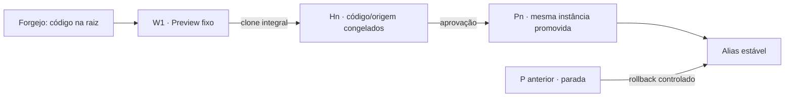

# Runtime gerenciado de projetos

A CloudIFF mantém o código-fonte separado da infraestrutura. O repositório do usuário contém apenas a aplicação; Dockerfile, Compose, Apache, Supervisor, healthcheck, imagens e metadados são gerados pela plataforma fora do Git.



## Estrutura do repositório

```text
index.php ou index.html
api/
  server.js
  package.json
assets/
src/
README.md
```

A raiz do repositório é a raiz da aplicação. Não existe uma pasta obrigatória `site/`. APIs Node opcionais ficam em `api/` e são expostas em `/api/`.

Os seguintes arquivos não pertencem ao repositório do projeto:

- `.cloudif/`;
- `docker-compose.yml`, `compose.yaml` ou equivalentes da plataforma;
- Dockerfiles gerados pela CloudIFF;
- `.env`, tokens e segredos;
- configuração de Apache, Supervisor ou healthcheck da plataforma.

## Runtime externo ao Git

A plataforma mantém Dockerfiles, Compose, healthchecks e metadados fora do repositório do projeto. No fluxo atual:

1. o Forgejo alimenta um único slot Wn de Preview, preservando o número histórico já existente;
2. atualizar código sincroniza o mesmo Wn e preserva sua identidade/URL;
3. criar H clona o runtime W saudável, incluindo rootfs/camada gravável corrente, volumes pertencentes ao projeto e configuração efetiva do estágio por referências seguras;
4. H não recebe commits novos automaticamente; variáveis podem ser alteradas explicitamente pelo usuário autorizado antes do aceite;
5. promover H→P muda papel/roteamento da própria instância aprovada, sem rebuild/reclone;
6. a P anterior é desativada somente depois do health/readback da nova; pode permanecer operacionalmente reativável ou ter seu runtime removido/arquivado conforme a política de histórico.

Builders, imagens e redes continuam gerenciados pela plataforma. O runtime concreto depende do projeto: PHP, Node.js, Python ou outros componentes só devem ser reportados quando realmente presentes no estágio selecionado. TLS é terminado no proxy nas portas públicas 80 e 443; os containers atendem na rede interna. Identificadores `dN` existem apenas para compatibilidade com publicações legadas e não definem o lifecycle novo.

### Alterações manuais no rootfs do Preview

O clone W→H captura o rootfs/camada gravável atual dos containers. Assim, pacote instalado manualmente pelo Terminal antes da homologação acompanha H e depois P. Isso é estado runtime, não garantia de persistência do Preview: `restart` preserva a camada do mesmo container, mas `recreate` a partir da imagem original pode descartá-la. Mudança durável deve preferir imagem, código, volume ou configuração gerenciada; alteração feita depois de H existir exige nova H.

## Publicação e retenção

O objetivo operacional é um Preview ativo e uma Produção ativa por projeto, com no máximo uma H ativa durante homologação. H promovida vira P e não permanece como runtime H; H substituída/não promovida pode ter runtime removido depois de preservar snapshot/evidência. Bridges e rotas antigas são reconstruíveis. Produção histórica só permanece na lista operacional enquanto houver runtime/artefato reativável. Ao usar `Excluir container`, o runtime é removido e a publicação passa a `archived`; Compose pode preservar snapshot, enquanto legado inativo pode usar exclusão final validada sem reidratação automática.


## Membros e permissões

Inclusões e remoções em projeto ou banco geram eventos de reconciliação. O estado completo atual é reaplicado em:

- colaboradores do Forgejo;
- permissões do Komodo;
- terminais individuais em todas as publicações existentes;
- listas de acesso do tenant Supabase;
- integrações e identidade MCP do projeto.

A remoção elimina apenas recursos que a CloudIFF gerenciou para aquele vínculo. O proprietário do projeto ou tenant continua protegido.

## Rede e HTTPS

Os containers atendem internamente na porta 80 e participam da rede `cloudif-publications`. O TLS é terminado no proxy público, que encaminha o endereço estável para o alias da versão ativa.

## Variáveis pertencem ao estágio ativo

A partir do contrato operacional vigente em 21/11/2026, Preview, Homologação e Produção não compartilham um cadastro de variáveis desacoplado do runtime. O ambiente exibido no Portal representa o container/deployment daquele estágio. Alterações feitas por um humano autenticado no próprio Portal são aplicadas diretamente ao runtime correspondente: sessão + CSRF + ACL do projeto são a autorização, sem uma segunda aprovação. Approval Service permanece para MCP/automação e contratos explicitamente críticos.

A herança é direcional: Preview → Homologação copia a configuração existente no Preview no instante do clone; Homologação → Produção copia a configuração corrente da H e promove o mesmo deployment. Alterações posteriores continuam permitidas no estágio ativo. Em Docker, editar `Env` pode substituir apenas os containers afetados, preservando deployment e volumes; isso não altera a regra de que a promoção H→P não faz rebuild/reclone.

Secrets são promovidos por referências com escopo próprio do ambiente e seus valores só são resolvidos em memória. Na tela humana, secrets ficam mascarados; campo vazio mantém o valor e um novo valor rotaciona/aplica no mesmo salvamento. `POSTGRES_PASSWORD` possui migração transacional de role + `DATABASE_URL` com preservação do volume; `POSTGRES_DB`/`POSTGRES_USER` permanecem alterações estruturais.

Homologações não promovidas/substituídas não são mantidas como runtime ocioso; Produções antigas ficam paradas apenas para rollback. O contrato detalhado e evidências mecânicas estão em `compat/cloudiff-stage-environment-runtime-contract.md`.

## Read-model do Portal

Leituras que dependem de filesystem, Komodo ou serviços remotos usam `portal_readmodel_cache`, pré-aquecido pelo timer existente e invalidado pelas mutações. O índice é descartável e nunca substitui as fontes canônicas. Projetos, tenants, contexto/estado de runtime, Publicações, Conectores e Aprovações devem evitar varredura pesada no caminho quente da interface.

## Refresh terminal, histórico e retenção

A H é congelada contra sincronização automática do Forgejo, mas aceita edição explícita das variáveis do próprio estágio antes do aceite. A P é a mesma H promovida; alterações posteriores de variáveis são mutações explícitas da Produção.

Jobs terminais de H, P e rollback disparam refresh do modal de Ambiente de publicação. Uma H publicada deixa de ser runtime ativo e não oferece Site/Terminal/Variáveis.

Produções históricas podem permanecer reativáveis enquanto houver runtime/artefato que sustente rollback. O Histórico prepara e valida a P alvo antes do cutover. Se `Excluir container` for usado, o runtime é removido e a publicação é arquivada: Compose pode manter snapshot; legado inativo pode ser removido definitivamente após validação Komodo. Bridges antigos são reconstruíveis e não devem permanecer consumindo runtime sem necessidade.

### Refresh terminal da interface

Ao concluir com sucesso a criação de H, a promoção H→P ou a reativação histórica, o Portal atualiza o workspace do ambiente e executa recarregamento completo da página. Falhas não recarregam automaticamente: a mensagem de erro permanece visível para diagnóstico. Isso evita depender de F5/manual refresh para exibir o estágio recém-concluído.

### Identidade fixa do Preview Wn e histórico de Produção

O Preview é fixo por projeto, mas o número do slot deve **preservar a identidade já existente**. Projetos novos podem iniciar em W1; projetos existentes não podem ser achatados/renumerados para W1. O sistema obtém o Wn canônico do histórico do projeto e mantém URL/bridge coerentes. Para o Agenda P1020, o slot canônico é **W3** (`1020-w3-preview.cloudiff.duckdns.org`).

Produções anteriores permanecem **Offline** por padrão. O Histórico separa três ações:

- **Subir**: liga o runtime histórico e publica somente a URL Pn para teste; não toca no endereço principal;
- **Desligar**: remove rota/bridge versionada e para o runtime, preservando containers/volumes necessários ao rollback;
- **Ativar no endereço principal**: somente quando a versão histórica está online/saudável, executa o cutover do domínio estável e só então desativa a Produção anterior.

O estado Online/Offline deve vir do runtime real, não apenas do banco do Portal. Uma P histórica online não significa Produção ativa. Apenas `is_active=1` + alias estável validado representam a Produção principal.
