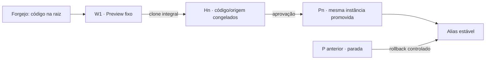

# Runtime gerenciado de projetos

A CloudIFF mantém o código-fonte separado da infraestrutura. O repositório do usuário contém apenas a aplicação; Dockerfile, Compose, Apache, Supervisor, healthcheck, imagens e metadados são gerados pela plataforma fora do Git.



## Estrutura do repositório

```text
index.php ou index.html
api/
  server.js
  package.json
assets/
src/
README.md
```

A raiz do repositório é a raiz da aplicação. Não existe uma pasta obrigatória `site/`. APIs Node opcionais ficam em `api/` e são expostas em `/api/`.

Os seguintes arquivos não pertencem ao repositório do projeto:

- `.cloudif/`;
- `docker-compose.yml`, `compose.yaml` ou equivalentes da plataforma;
- Dockerfiles gerados pela CloudIFF;
- `.env`, tokens e segredos;
- configuração de Apache, Supervisor ou healthcheck da plataforma.

## Runtime externo ao Git

A plataforma mantém Dockerfiles, Compose, healthchecks e metadados fora do repositório do projeto. No fluxo atual:

1. o Forgejo alimenta um único slot W1 de Preview;
2. atualizar código sincroniza o mesmo W1 e preserva sua identidade/URL;
3. criar H clona o runtime W saudável, incluindo a configuração efetiva do estágio por referências seguras;
4. H não recebe commits novos automaticamente; variáveis podem ser alteradas explicitamente pelo usuário autorizado antes do aceite;
5. promover H→P muda papel/roteamento da própria instância aprovada, sem rebuild/reclone;
6. a P anterior é parada somente depois do health/readback da nova e permanece enquanto necessária para rollback exato.

Builders, imagens e redes continuam gerenciados pela plataforma. A imagem-base segue o padrão `cloudif/runtime-apache-php8.3-node22:v2`, ajustado às versões de PHP e Node selecionadas. TLS é terminado no proxy nas portas públicas 80 e 443; os containers atendem na rede interna. Identificadores `dN` existem apenas para compatibilidade com publicações legadas e não definem o lifecycle novo.

## Publicação e retenção

O objetivo operacional é um Preview ativo e uma Produção ativa por projeto, com no máximo uma H ativa durante homologação. H promovida vira P e não permanece como runtime H; H substituída/não promovida pode ter runtime removido depois de preservar snapshot/evidência. Bridges e rotas antigas são reconstruíveis. Produções históricas podem manter containers/volumes parados enquanto forem necessários para rollback do estado persistente.


## Membros e permissões

Inclusões e remoções em projeto ou banco geram eventos de reconciliação. O estado completo atual é reaplicado em:

- colaboradores do Forgejo;
- permissões do Komodo;
- terminais individuais em todas as publicações existentes;
- listas de acesso do tenant Supabase;
- integrações e identidade MCP do projeto.

A remoção elimina apenas recursos que a CloudIFF gerenciou para aquele vínculo. O proprietário do projeto ou tenant continua protegido.

## Rede e HTTPS

Os containers atendem internamente na porta 80 e participam da rede `cloudif-publications`. O TLS é terminado no proxy público, que encaminha o endereço estável para o alias da versão ativa.

## Variáveis pertencem ao estágio ativo

A partir do contrato operacional vigente em 21/11/2026, Preview, Homologação e Produção não compartilham um cadastro de variáveis desacoplado do runtime. O ambiente exibido no Portal representa o container/deployment daquele estágio e toda alteração aprovada é aplicada ao runtime correspondente.

A herança é direcional: Preview → Homologação copia a configuração existente no Preview no instante do clone; Homologação → Produção copia a configuração corrente da H e promove o mesmo deployment. Alterações posteriores continuam permitidas no estágio ativo. Em Docker, editar `Env` pode substituir apenas os containers afetados, preservando deployment e volumes; isso não altera a regra de que a promoção H→P não faz rebuild/reclone.

Secrets são promovidos por referências com escopo próprio do ambiente e seus valores só são resolvidos em memória. Variáveis de bootstrap de PostgreSQL persistente exigem migração própria e são bloqueadas para alteração direta enquanto não houver essa operação.

Homologações não promovidas/substituídas não são mantidas como runtime ocioso; Produções antigas ficam paradas apenas para rollback. O contrato detalhado e evidências mecânicas estão em `compat/cloudiff-stage-environment-runtime-contract.md`.

## Refresh terminal, histórico e retenção

A H é congelada contra sincronização automática do Forgejo, mas aceita edição explícita das variáveis do próprio estágio antes do aceite. A P é a mesma H promovida; alterações posteriores de variáveis são mutações explícitas da Produção.

Jobs terminais de H, P e rollback disparam refresh do modal de Ambiente de publicação. Uma H publicada deixa de ser runtime ativo e não oferece Site/Terminal/Variáveis.

Produções históricas podem permanecer com containers/volumes parados para rollback exato. O Histórico reativa esses containers, exige health, recria bridge/rota se necessário, valida a URL estável e só depois desativa a P anterior. Bridges antigos não precisam ficar parados consumindo metadados; são reconstruíveis.
